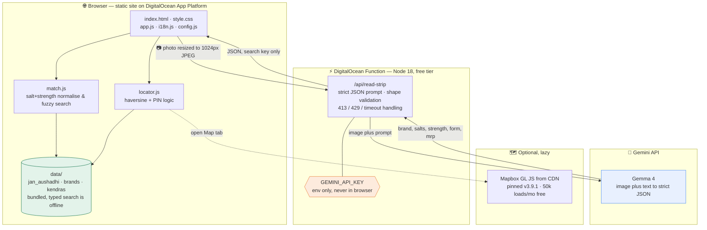
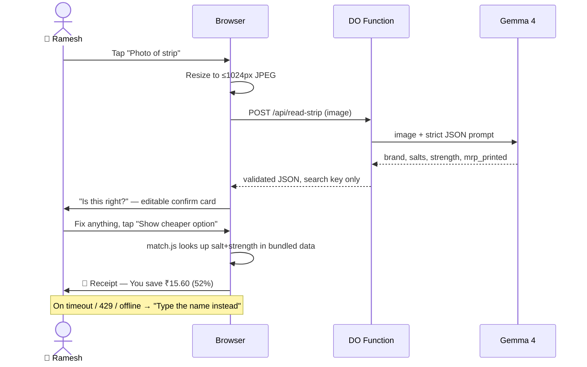

<div align="center">

# 💊 DawaDekho — दवा देखो

### _Dawa dekho, daam dekho._ **See the medicine. See the price. Before you pay.**

Photograph or type a branded Indian medicine → see the **Jan Aushadhi generic with the same salt and strength**, and exactly **how much you save** — big type, Hindi or English, on a ₹8,000 phone, at the chemist's counter.

[](LICENSE)
[](tests/)
[](#-tech-stack)
[](#-the-golden-rule-why-you-can-trust-it)
[](#-deploy-0-free-tiers)
[](#-accessibility)

**Hackfest Lucknow** · GDG on Campus SRMCEM × MLH · 21 Oct 2026
Problem Statement **#3 — "The Prescription You Cannot Read"**
Tracks: 🏆 **Best Use of Gemma 4** · 🌊 **DigitalOcean Best Open-Source AI Project**

</div>

---

## 📖 Table of contents

- [The problem, in 20 seconds](#-the-problem-in-20-seconds)
- [✨ Key features](#-key-features)
- [🏛️ Architecture](#-architecture)
- [🔄 How the photo flow works](#-how-the-photo-flow-works)
- [🔒 The golden rule (why you can trust it)](#-the-golden-rule-why-you-can-trust-it)
- [🧠 What Gemma does, and where it fails](#-what-gemma-does-and-where-it-fails)
- [📍 Find a Kendra (locator)](#-find-a-kendra-locator)
- [🧩 Tech stack](#-tech-stack)
- [🗂️ Project layout](#-project-layout)
- [▶️ Run it locally](#-run-it-locally)
- [🧪 Develop & test](#-develop--test)
- [🚀 Deploy (₹0, free tiers)](#-deploy-0-free-tiers)
- [📊 Data & honesty](#-data--honesty)
- [♿ Accessibility](#-accessibility)
- [🙏 Credits & tools](#-credits--tools)
- [📄 License](#-license)

---

## 💡 The problem, in 20 seconds

A patient is handed a prescription of brand names and pays whatever the chemist says. The **same molecule** is often sold under a government **Jan Aushadhi** generic for a fraction of the price — but nobody shows the patient the cheaper option *before the bill is paid*.

DawaDekho closes that gap in one tap:

```
Ramesh's strip:   Dolo 650              ₹30.00
Jan Aushadhi:     Paracetamol 650mg     ₹14.40
                  ─────────────────────────────
                  YOU SAVE   ₹15.60   (52%)
```

- ⌨️ **Type** a name (typos welcome) → answer in **< 1 s**, works **offline**.
- 📷 **Photo** a strip → **Gemma 4** reads the printed brand, salt, strength & MRP → you confirm → see the generic and the saving.

---

## ✨ Key features

> The headline capabilities, each built to work on a weak signal, in Hindi, for a first-time user.

| | Feature | Why it matters |
|:--:|---|---|
| 📷 | **Gemma 4 strip reader** | Point the camera at a printed strip; Gemma returns `{brand, salts, strength, form, mrp_printed}` as **strict JSON** — used only as a *search key*, never as a source of truth. |
| ⌨️ | **Typo-proof typed search** | `dolo65o`, `pan 40`, `crosin` all resolve correctly. Salt + strength normalisation (acetaminophen = paracetamol; order-independent strengths) + a hand-written fuzzy matcher. |
| 🧾 | **The "honest receipt" result** | Branded MRP struck through, Jan Aushadhi price below, and a **huge count-up savings figure** with the percent. Tabular figures line up like a pharmacy bill. |
| 🛡️ | **Never invents a fact** | Every drug, price and alternative comes **only** from `data/*.json`. Below the match threshold it says *"Not in our list — ask your pharmacist."* |
| 📍 | **Kendra locator** | "Use my location" **or** PIN code → nearest Jan Aushadhi Kendras sorted by distance, with **Directions** and **Call**. List-first; optional lazy **Mapbox** map with clustering. |
| 🌐 | **Bilingual (English + हिंदी)** | Every string in both languages, remembered on the device, with `<html lang>` switching for screen readers. |
| 🌗 | **Light / dark mode** | Follows the system **and** has a manual toggle, remembered per device. |
| 📴 | **Works on a weak network** | Typed search is fully **offline** (data bundled). The photo path has a 15 s timeout and always falls back to typing. |
| 🔐 | **Private by design** | No login, no cookies, no analytics. Photos are resized in the browser, sent once, and never stored. |
| ♿ | **Accessible** | WCAG 2.1 AA: 18 px base text, ≥48 px targets, visible focus, full keyboard, status in **words + icon**, screen-reader savings announcement. |
| 💸 | **₹0 to run** | Static site + one serverless function on DigitalOcean free tiers. No framework, first load **< 300 KB**. |
| ✅ | **Honest, tested, open** | MIT, 17 passing tests, a data validator in CI, and small transparent commits. |

---

## 🏛️ Architecture

Everything the user needs for the **typed** path is bundled and offline. Only the **photo** path touches the network, and the Gemini key lives **only** in the serverless function — never in the browser.



**Matching** ([`match.js`](match.js)): salts are normalised (lowercased, aliased — e.g. _acetaminophen = paracetamol_ — and sorted) and strengths reduced to an order-independent multiset, so `telmisartan+amlodipine 40mg+5mg` and `amlodipine + telmisartan 5 mg + 40 mg` are the **same key**. Typed queries fuzzy-resolve a brand/salt first (Levenshtein, tuned threshold), then the key is looked up in the Jan Aushadhi data. Savings use the **strip-printed MRP** when available (exact), otherwise a clearly-labelled **approx** brand price.

---

## 🔄 How the photo flow works



---

## 🔒 The golden rule (why you can trust it)

> **Gemma only reads. The data decides.**

| Gemma 4 **may** | Gemma 4 **must never** |
|---|---|
| Read printed text from a strip/box photo | Invent a drug, salt, price or alternative |
| Normalise a misspelt brand into `{brand, salts, strength}` | Give dosage or medical advice |
| Return `null` when unsure | Fill gaps with guesses |

Every generic name, pack size, drug code and price shown to the user comes **only** from [`data/jan_aushadhi.json`](data/jan_aushadhi.json). Gemma's output is used by the browser **only as a search key**. If nothing matches confidently, the app says _"Not in our list — ask your pharmacist"_ and never guesses. This boundary is enforced in **both** the prompt ([`packages/api/read-strip/index.js`](packages/api/read-strip/index.js)) and the matcher ([`match.js`](match.js)), and is covered by tests.

---

## 🧠 What Gemma does, and where it fails

**✅ Does well:** reads a clean, flat, well-lit **printed** strip or box — brand, salt, strength, form, and the printed MRP. Normalises odd spacings and brand-vs-molecule naming into a search key.

**⚠️ Fails / we handle it:**
- **Handwriting** — out of scope by design (the brief calls it a trap). The function detects it (`handwriting:true`); the UI says _"We read printed strips and boxes, not handwriting."_
- **Blurry / glare / folded strip** — may misread. That is exactly why the photo flow has an **editable confirm step** before any result.
- **A medicine not in our ~200-item demo dataset** — honest no-match, no guess.
- **Rate limit / timeout / offline** — the typed path needs no AI at all and is always offered as a fallback.

---

## 📍 Find a Kendra (locator)

Every result links to **"Find nearest Jan Aushadhi Kendra"**, and the footer has a persistent **"Kendras near me"**. The locator:

- 🧭 Offers **"Use my location"** (geolocation, explained before the prompt and **never stored**) **and** a **PIN code** fallback — if location is denied it moves you to the PIN field, **no dead end**.
- 📋 Shows a **list first** (works with **no map**): each Kendra has its address, distance, **Directions** (Google Maps) and **Call** (when a phone is known), with an _"Approx location"_ tag where the coordinate is approximate.
- 🗺️ Loads an optional **Mapbox** map **lazily** (only when you open the Map tab, to save map loads) — clustering, a "you are here" marker, and list ↔ marker sync. If no token is set or the map fails, the map tab is simply hidden and **the list keeps working** (never a blank box).

The locator maths ([`locator.js`](locator.js)) is pure and covered by [`tests/locator.test.mjs`](tests/locator.test.mjs).

---

## 🧩 Tech stack

| Layer | Choice | Note |
|---|---|---|
| **Front end** | Vanilla HTML/CSS/JS | No framework, no build step, first load < 300 KB |
| **Matching / locator** | Hand-written UMD modules | Run in the browser **and** in Node tests — zero installs |
| **AI** | Gemma 4 via Gemini API | Multimodal, strict-JSON, behind a serverless boundary |
| **Serverless** | DigitalOcean Function (Node 18) | Global `fetch`, no runtime dependencies |
| **Hosting** | DigitalOcean App Platform | Free static site + function |
| **Map** | Mapbox GL JS (CDN, lazy) | Optional enhancement; graceful fallback |
| **Fonts** | Mukta + IBM Plex Mono | Devanagari + Latin; tabular receipt figures |
| **Tests** | Node built-in test runner | `node --test`, no dependencies |

---

## 🗂️ Project layout

| Path | What |
|---|---|
| `index.html`, `style.css`, `app.js`, `i18n.js` | Static front end (no framework) |
| `match.js` | Matching engine (UMD — runs in browser **and** Node tests) |
| `locator.js` | Kendra distance + PIN logic (UMD, pure) |
| `config.js` | Public runtime config (Mapbox token — no secrets) |
| `data/jan_aushadhi.json` | Jan Aushadhi generics (curated PMBI snapshot) |
| `data/brands.json` | ~45 common Indian brands → salt + strength |
| `data/kendras.json` | Lucknow Jan Aushadhi Kendras (demo snapshot) |
| `packages/api/read-strip/` | Gemma 4 serverless function |
| `scripts/validate-data.js` | Dataset integrity check (CI) |
| `scripts/build-kendras.py` | Reproducible Kendra geocoding pipeline (Nominatim) |
| `tests/match.test.js`, `tests/locator.test.mjs` | Tests (`node --test`) |
| `project.yml`, `.do/app.yaml` | DigitalOcean deploy config |
| `docs/` | PRD, design system, UX copy, SEO, UI audit |

---

## ▶️ Run it locally

No build, no install needed for the site:

```bash
# any static server works; Python is everywhere
python3 -m http.server 8080
# open http://localhost:8080
```

Typed search and the Kendra locator work fully offline/local. The **photo** path needs the serverless function running with a Gemini API key (see [Deploy](#-deploy-0-free-tiers)).

---

## 🧪 Develop & test

No dependencies to install — tests use Node's built-in runner.

```bash
npm run validate-data   # dataset clean: salt/strength/price; Kendras in Lucknow bbox
npm test                # matching, savings, Gemma boundary, locator (distance/PIN)
npm run check           # both of the above
```

✅ **17 tests** cover the typo set, savings math, honest no-match, the Gemma golden-rule boundary, haversine distance, and PIN handling.

---

## 🚀 Deploy (₹0, free tiers)

1. **Static site** — DigitalOcean App Platform reads [`.do/app.yaml`](.do/app.yaml) and serves the repo root. Push to `main` → auto-deploy.
2. **Function** — `doctl serverless deploy .` using [`project.yml`](project.yml), or App Platform deploys it from the same spec.
3. **Secret** — set `GEMINI_API_KEY` as an encrypted env var in the DO dashboard (**never** in the repo). Get a free key from Google AI Studio.
4. **Mapbox token (optional, for the Kendra map)** — put a **public** token (`pk.…`) in [`config.js`](config.js) as `MAPBOX_TOKEN`. Restrict it by URL to your app domain and `localhost`, with only the map read scopes (styles/fonts/sprites/tiles). **Never** use a secret token (`sk.…`) in the browser. Leave it empty to run the locator in list-only mode. Mapbox's free tier covers 50,000 web map loads/month, and the map loads lazily.
5. **Rebuild the Kendra data (optional)** — run `pip install pdfplumber requests && python3 scripts/build-kendras.py --pdf-url <url> --district Lucknow` to regenerate `data/kendras.json` from the official PDF with live Nominatim geocoding.
6. Replace the placeholder URLs (`dawadekho.ondigitalocean.app`) in `index.html`, `robots.txt`, `sitemap.xml` and this README with your real URL.

> **Live demo:** _add your DigitalOcean URL here after deploy_ → `https://dawadekho.ondigitalocean.app/`

---

## 📊 Data & honesty

- **Source:** official Pradhan Mantri Bhartiya Janaushadhi Pariyojana (PMBJP) product list, [janaushadhi.gov.in](https://janaushadhi.gov.in/). **Snapshot: 2026-10-01.** This repo ships a **curated ~200-item demo subset**, not the full list — the problem statement rightly warns that _200 drugs done well beats 20,000 done badly_. Verify prices against the live PMBI list before any real-world use.
- Brand `approx_mrp` values are typical retail prices, **always labelled "approx"** in the UI; the real branded price is the MRP on your own strip.
- **Kendra data:** records come from the all-India Jan Aushadhi Kendra list PDF (PMBI, dated **Oct 2025**). `data/kendras.json` ships a **curated ~35-Kendra Lucknow demo** with approximate area coordinates (`approx_location: true`, phones left `null`) so the locator works out of the box. Run `scripts/build-kendras.py` to regenerate the authoritative, geocoded version. Coordinates are **© OpenStreetMap contributors (ODbL)**, geocoded via Nominatim; Mapbox is used only to _display_ the map, never to store geocodes.
- **Not medical advice.** Every result says: _"Information only. Confirm with your doctor or pharmacist before switching."_

---

## ♿ Accessibility

WCAG 2.1 AA target: **18 px** base text, **≥48 px** touch targets, visible **3 px** focus ring, full keyboard combobox, status in **words + icon** (readable in grayscale), `lang` switches with the language, works at **200 % zoom** and **320 px** width, respects `prefers-reduced-motion`, and the saving is announced to screen readers (_"You save 15 rupees, 52 percent"_).

---

## 🙏 Credits & tools

- **[Gemma 4](https://ai.google.dev/gemma)** via the **[Gemini API](https://ai.google.dev/)** — reads the printed strip.
- **[DigitalOcean App Platform & Functions](https://www.digitalocean.com/products/app-platform)** — free static hosting + serverless.
- **[PMBI / Jan Aushadhi](https://janaushadhi.gov.in/)** — the generic medicine data this is all built on.
- **[Google Fonts](https://fonts.google.com/)** — Mukta (Devanagari + Latin) and IBM Plex Mono (receipt figures).
- **[Mapbox GL JS](https://www.mapbox.com/)** — the Kendra map. Note: Mapbox GL JS v2+ is under the **Mapbox Terms of Service** (not an OSI licence); it is a runtime dependency loaded from Mapbox's CDN and is **not** redistributed in this repo. The DawaDekho application code itself stays **MIT**.
- **[OpenStreetMap](https://www.openstreetmap.org/copyright) / [Nominatim](https://nominatim.org/)** — Kendra coordinates (geocoded data), **© OpenStreetMap contributors, ODbL**.
- Matching and locator maths are small hand-written engines (no Fuse.js) so the test suite runs with **zero installs**.
- Built with the help of **AI coding assistants** (Claude) during the hackathon build window.

---

## 📄 License

[MIT](LICENSE) — the application code. Contributions welcome — see [CONTRIBUTING.md](CONTRIBUTING.md).

<div align="center">

**_Dawa dekho, daam dekho._** 💊 Made for 18,000+ Jan Aushadhi Kendras, any city, zero running cost.

</div>
